


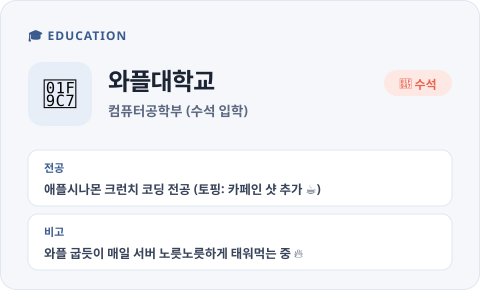

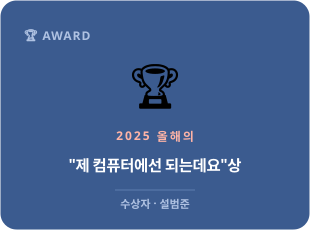


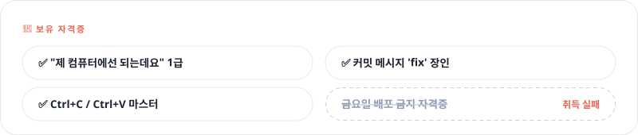

<a href="https://seol8852.github.io/my-web-projects/usa-roadtrip/"></a>
<a href="https://seol8852.github.io/my-web-projects/tokyo-trip/"></a>
<a href="https://seol8852.github.io/my-web-projects/chiikawa-web/">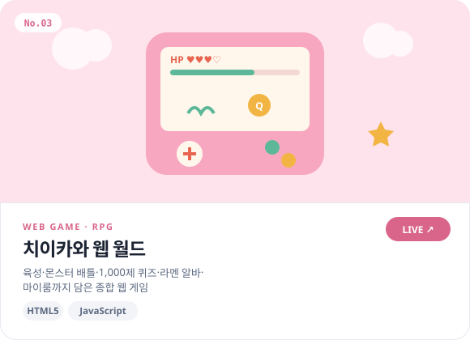</a>
<a href="https://seol8852.github.io/my-web-projects/madmax-witness-me/"></a>
<a href="https://seol8852.github.io/my-web-projects/smoke-action-game/"></a>
<a href="https://seol8852.github.io/my-web-projects/bj-solution/">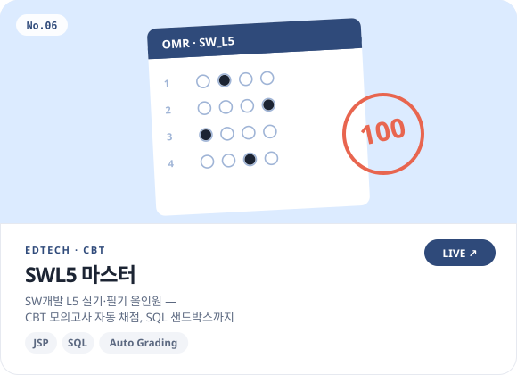</a>
<a href="https://seol8852.github.io/my-web-projects/myopic-segmentation/"></a>
<a href="https://seol8852.github.io/my-web-projects/chiikawa-action-game/"></a>
<a href="https://seol8852.github.io/my-web-projects/chiikawa-jungchogi/">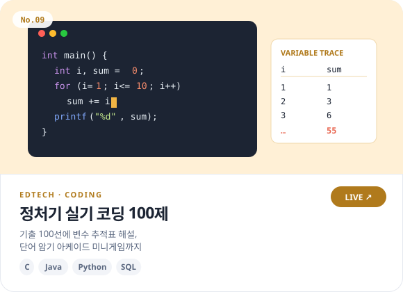</a>
<a href="https://seol8852.github.io/my-web-projects/chiikawa-3d-world/"></a>
<a href="https://github.com/seol8852/Talking_Photato">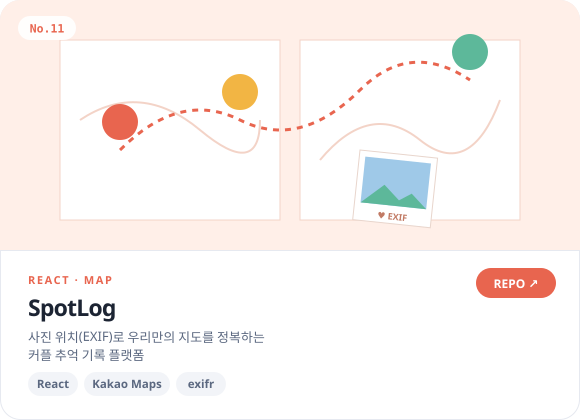</a>
<a href="https://seol8852.github.io/my-web-projects/">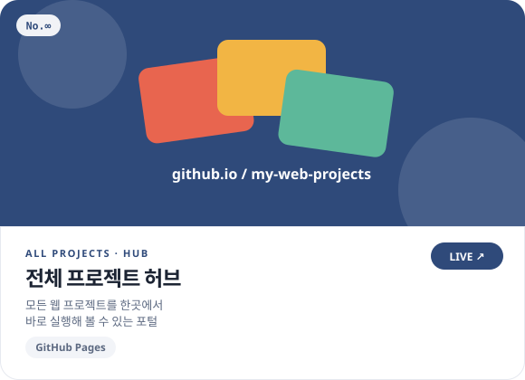</a>

카드를 누르면 실제 배포된 웹이 바로 열려요 · <a href="https://seol8852.github.io/my-web-projects/">전체 허브</a> · <a href="https://github.com/seol8852?tab=repositories">저장소 목록</a>

 

<h3>🛠 Tech Stack</h3>
  

    
    
    
    
    
  

   

  <!-- 깃허브 통계 카드 & 최다 사용 언어 -->
  <h3>📊 GitHub Stats</h3>
  
  

   

  <!-- 연속 잔디 스트릭 -->
  

    

  <!-- 업적 트로피 -->
  

    

  <!-- 방문자 수 카운터 -->
  

    👀 Profile Views: 
    
  

