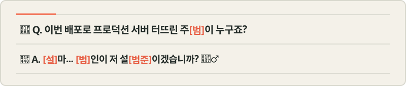
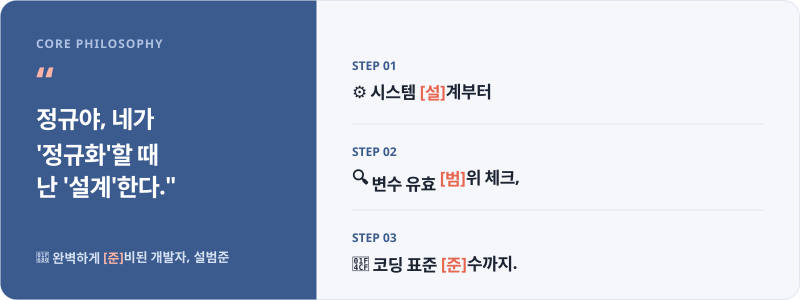
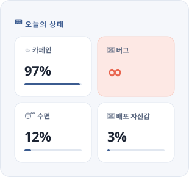

  <!-- 상단 Q&A 배너 -->
  
    

  <!-- 메인 철학 카드 -->
  
    

  <!-- 학력 & 상태 -->
  
  

    

  <!-- 자격증 -->
  

    

  <!-- 기술 스택 -->
  <h3>🛠 Tech Stack</h3>
  

    
    
    
    
    
  

   

  <!-- 깃허브 통계 카드 & 최다 사용 언어 -->
  <h3>📊 GitHub Stats</h3>
  
  

   

  <!-- 연속 잔디 스트릭 -->
  

    

  <!-- 업적 트로피 -->
  

    

  <!-- 방문자 수 카운터 -->
  

    👀 Profile Views: 
    
  

